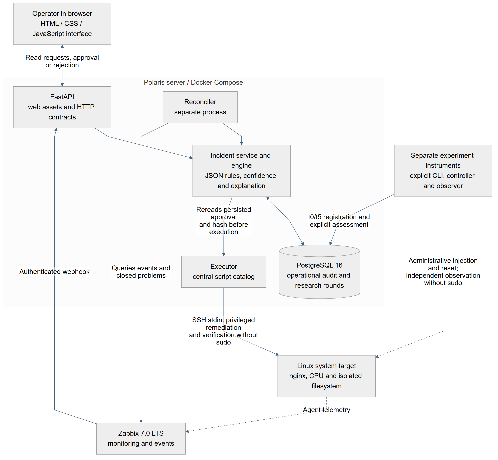
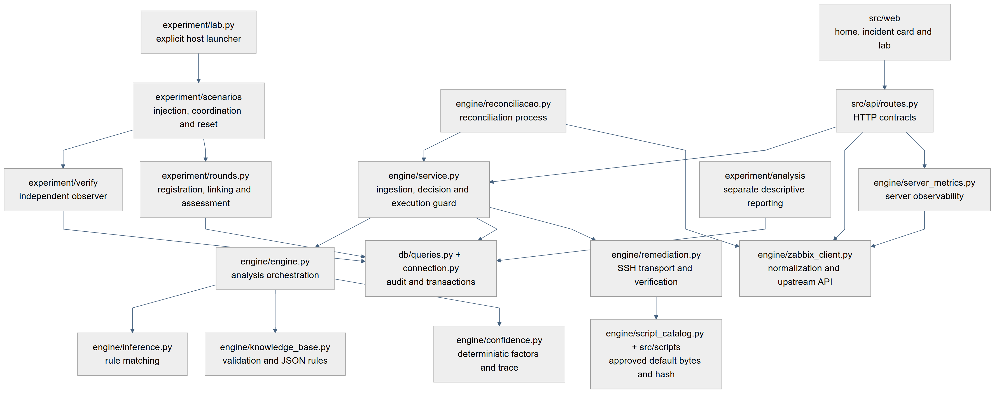
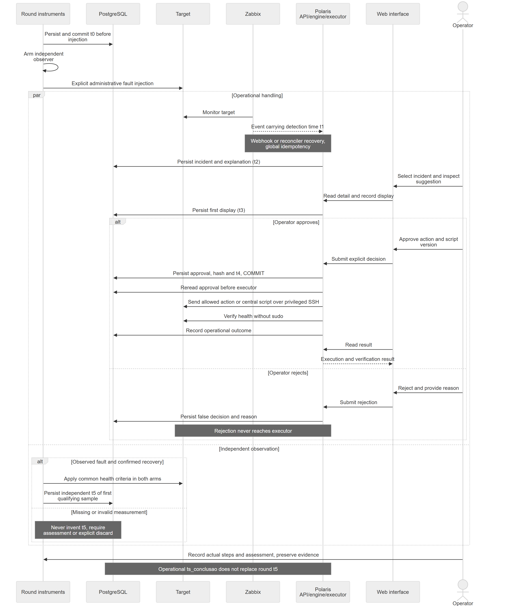

# Architecture and operational boundaries

Polaris is a rule-based decision support application built with Python/FastAPI, a JSON knowledge
base, PostgreSQL and a vanilla HTML/CSS/JavaScript interface. It uses Zabbix 7.0 LTS JSON-RPC
telemetry and one explicitly configured SSH remediation target. There is no runtime LLM or ML model.
The confidence value is a heuristic index, not an estimated probability of success.

## Ingestion and reconciliation

Zabbix sends events to `POST /webhook/zabbix` with `X-Polaris-Token`. A separate reconciler polls
open events, recovers missed deliveries and records closure at the monitoring source. It never
approves a recommendation. Run one reconciler process independently of API workers.

The shared ingestion service normalizes an event, checks its global event identity, evaluates
enabled rules and persists the result/explanation. The current KB contains R001 disk pressure,
R002 CPU pressure and R003 nginx down. An unmatched event is retained with no assigned rule.
Event redelivery is idempotent, including unmatched events; it does not erase or replace decisions.

Valid literal `host_ip` is retained in `audit_log.ip_address`. Reconciliation accepts only a
single host with exactly one primary, IP-based agent interface. Missing or ambiguous identity
stays absent and can prevent an experimental link. This metadata does not select an SSH destination:
execution uses `TARGET_SSH_HOST`, and the current deployment is not a multi-target dispatcher.

## Read-only diagnosis and action plans

After committing the incident, a bounded fixed collector gathers target evidence before presentation.
This read-only path is separate from the remediation executor. The card offers only applicable
operations with specific targets; approval binds the chosen option and snapshot. See
[action plans and preferences](action_plans.md) for retention, identity checks and history modes.

## Human decision before execution

The browser renders the incident and marks its first display. The operator examines evidence,
confidence, proposed command and script effects, then explicitly approves or rejects. Low-confidence
suggestions require additional confirmation. The script catalog hash binds approval to script bytes.

The application commits `decisao_humana=true`, `ts_aprovacao`, operator label and script version
before dispatch. The executor re-reads persisted approval and refuses execution without it.
A rejection records its reason and cannot dispatch a remedy. The operator label is self-reported;
the interface does not authenticate a person's identity.

Scripts are central in the image and sent over SSH stdin. They are not copied into an executable
directory on each target. Operational verification uses read-only scripts without sudo. Execution
result and completion time are persisted; a successful command is not, by itself, experimental
correctness or the experiment's independent recovery timestamp.

## Monitoring and browser behavior

Zabbix remains the primary infrastructure monitor. Polaris provides decisions and remediation
follow-up. An empty decision queue, green connection indicator or healthy API does not establish
whole-infrastructure health. Browser-hidden records and the default unmatched-alert filter do not
delete audit data or hide pending decisions. Decision history counts actual persisted approvals
and rejections, independently of execution outcome and the research KPI cohort.

Optional server CPU/memory readings use `POLARIS_ZABBIX_HOST`, independently of the SSH target.
Unavailable or stale samples are shown as unavailable. They do not ingest alerts or grant remediation.

## Experimental instrumentation

The [laboratory helper](../experiment/laboratorio.md) is an explicit operator-run tool. It records
injection time before arming an observer and injecting a declared scenario using a separate
administrative SSH credential. It never approves incidents. The independent observer uses the
same verifier/recovery criteria in baseline and HITL and writes only `ts_verificado_ok`.
The operator records actual steps and correctness separately; reset is explicit and follows
assessment/discard and evidence preservation. Official collection still requires laboratory rehearsal.

The parallel observer branch runs independently of operational execution. `ts_conclusao` does
not replace its t5. The sequence represents an instrumented round, not every daily incident.

## Security scope

The persisted-approval invariant is enforced by application paths. It does not constrain someone
with direct database writes, code deployment rights or the target's root-capable SSH credential.
The current target sudo authorization for `/usr/bin/timeout` is broad: it permits an arbitrary
command under that wrapper. Application allowlists/script hashes do not make this credential a
command-restricted OS account. Keep the target disposable and the service key protected.

Guided setup stores connections and the service private key using authenticated encryption,
with the master key in a separate persistent volume. The API writes the vault; the reconciler
mounts both volumes read-only. Optional legacy files use a dedicated Compose override.
Unknown or changed SSH host keys are rejected. The separate laboratory administrative key is
mounted only into temporary laboratory containers for administrative actions.

The prototype has no individual operator login/RBAC. When the setup vault is enabled (default
Compose), a strong locally bootstrapped administrative code unlocks a short session for setup and
mutating API routes. Origin checking and an HttpOnly/SameSite cookie protect these requests;
remote access requires HTTPS. Read-only operational routes remain network-readable. The webhook
retains its separate token. This shared administrative capability does not prove who approved an
incident or replace the persisted approval. Test receipts bind session, candidate and revision,
expire after five minutes and are consumed on save. Connection changes fail closed for open
incidents or unavailable DB; file locks serialize them against API/reconciler operations.
Default Compose publishes API/database ports on all host interfaces. Use an isolated,
access-controlled laboratory network; production authentication, TLS/access policy and restricted
credentials require further work. Environment secrets are not automatically encrypted/removed.
Debug alert injection must stay disabled for controlled runs.
